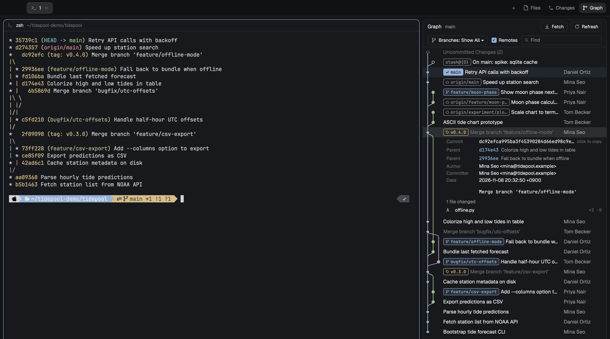

# herdr-git-graph

[English](README.md) · **한국어**

VS Code의 Git Graph 화면을 Herdr 사이드 패널에 네이티브로 다시 만든 mod입니다. Git Graph의
우클릭 메뉴 전체(커밋, 브랜치, 현재 브랜치, 원격 브랜치, 태그, 커밋 안 된 변경, stash —
Drop, Fetch into local, Archive 포함)를 제공하고, 각 작업 직전에 대상이 그대로인지 다시
확인하며, 되돌리기 어려운 작업은 클릭으로만 확인합니다. 스페이스마다 하나씩 쓰는 Diff
탭(또는 옆 분할 패널)에서 unified / 좌우 비교로 볼 수 있고, 브랜치 필터 드롭다운과 검색(Find)도
있습니다. VS Code Git Graph 확장의 코드는 쓰지 않았습니다. 처음부터 만드는 방법은
`RECIPE.md`(영문)에 있습니다.



## 기능 (그래프 외)

- **Copy Commit Message / Copy Stash Message to Clipboard**: 우클릭 메뉴에서 제목과 본문을
  포함한 메시지 전체를 복사합니다. 선택할 때 `git log -1 --format=%B`로 읽습니다.
- **커밋 상세 텍스트 선택**: 펼친 커밋의 메시지 본문과 Author / Committer / Date 값을
  드래그해서 cmd-c로 복사할 수 있습니다. 전체 해시는 클릭하면 복사됩니다.
- **Diff를 별도 탭으로** (기본값): 파일을 클릭하면 스페이스의 **Diff** 탭 하나가 열리고(처음
  한 번 열고 이후 재사용), diff 헤더의 **Open in: Tab | Pane**으로 작업 옆에 분할해 보는 방식으로
  바꿀 수 있습니다. 이 선택은 공유 설정(`git-graph.diffWhere` = `tab` | `split`)에 저장됩니다.
  Esc 또는 ✕로 diff 탭(또는 패널)을 닫습니다. 같은 탭에 터미널을 함께 띄워 두었다면 diff
  패널만 닫힙니다. diff에 포커스가 있는 동안에도 Graph는 보던 저장소를 계속 보여줍니다.
- **브랜치 라벨**: 고정폭 글꼴로 그려 너비가 정확히 맞습니다(22자를 넘는 이름은 "…"로
  줄임). 이름 앞에 아이콘이 붙습니다(브랜치, 현재 브랜치는 체크, 원격 브랜치는 구름, 태그,
  detached HEAD는 커밋). 같은 커밋에 있는 로컬 브랜치와 같은 이름의 원격 브랜치는 한
  라벨(`main | origin`)로 묶이고, 우클릭·더블클릭은 포인터 아래의 부분에 적용됩니다. 현재
  브랜치 라벨은 레인 색으로 채워져 맨 앞에 오고, HEAD 줄에는 그 색이 옅게 깔립니다.
- **브랜치 라벨 더블클릭으로 체크아웃** (원격 브랜치는 Checkout 대화상자가 열림). 라벨을 한 번
  클릭하면 줄만 선택되고 상세는 열리지 않습니다.
- **커밋을 펼치면 자동 스크롤**: 펼친 커밋과 상세 정보가 화면에 들어오도록 필요한 만큼만
  스크롤합니다.
- **레인 색**: 테마의 ansi 팔레트에서 파랑부터 시작하는 12색을 씁니다. 파스텔 테마에서도 선명하도록 채도를 최대로 올려 칠합니다.
- **Fetch 시 prune**: 헤더의 Fetch는 `git fetch --all --prune`을 실행해, 서버에서 지운 원격
  브랜치(머지 후 삭제한 PR 브랜치)가 그래프에서 사라집니다. 로컬 브랜치는 건드리지 않습니다.
- **브랜치 드롭다운**은 그래프를 밀어내지 않고 그 위에 떠서 열립니다.

## 설치 (개발용)

```sh
scripts/link.sh          # mods/* 를 ~/.config/herdr-app/mods 로 복사
scripts/watch-copy.sh    # 편집하는 동안 복사본을 계속 동기화 (fswatch 필요)
scripts/link.sh --link   # 복사 대신 심볼릭 링크 (아래 참고)
```

Herdr의 핫 리로드는 심볼릭 링크로 연결한 mod 폴더의 수정 사항을 반영하지 않습니다(확인함:
`herdr-app check`는 통과하지만 열려 있는 패널은 예전 화면을 유지). 복사한 폴더는 바로
다시 읽히므로 복사가 기본입니다. 스크립트는 자기가 만들지 않은 실제 폴더를 덮어쓰지 않습니다.

테스트: `npm test`

## 오른쪽 패널에 설치

Herdr에 기본으로 들어 있는 레이아웃(`main`, `terminals`, `win98`)은 Herdr가 관리합니다. 시작할
때마다 원래대로 교체되고, 수정한 것은 `<이름>-edited`로 옮겨집니다. 그래서 레이아웃을
복제하고, 복제본만 패치한 뒤 그것으로 전환합니다.

```sh
HA=/Applications/Herdr.app/Contents/MacOS/Herdr
scripts/link.sh
$HA do layout.clone '{"name":"main","as":"main-graph"}'   # 복제하면서 그 레이아웃으로 전환됨
node scripts/patch-layout.mjs ~/.config/herdr-app/layouts/main-graph.json
$HA do layout.switch '{"name":"main-graph"}'
```

패치는 `panel-body` 스택에 `graph` 블록을 추가하고, 탭 바 `tabs`를 `git-graph-tabs`(Changes
뒤에 Graph 버튼을 넣은 `tabs` 복제본)로 바꿉니다. 여러 번 실행해도 결과가 같고,
`main.json`, `terminals.json`, `win98.json`은 거부하며(종료 코드 1, 아무것도 쓰지 않음), 처음
패치할 때 한 번만 `<레이아웃>.json.bak`(첫 패치 전 상태)을 남깁니다. Graph 버튼은
`panel-body`에 `graph` 블록이 있는 레이아웃에서만 보이므로, 다른 레이아웃에서는
`git-graph-tabs`가 영향을 주지 않습니다.

이 저장소의 `mods/` 폴더가 원본입니다. 여기서 수정하고 `scripts/link.sh`를 다시 실행하세요.
`~/.config/herdr-app/mods`에 있는 복사본은 직접 고치지 마세요.

## 되돌리기

수정한 적 없는 기본 레이아웃으로 전환합니다(`$HA do layout.switch '{"name":"main"}'`).
필요하면 `<복제본>.json.bak`을 복제본 위에 덮어써서 처음 상태로 돌리거나 복제본을 지웁니다.
그다음 `~/.config/herdr-app/mods/git-graph`와 `~/.config/herdr-app/mods/git-graph-tabs`를
지웁니다.

## 알려진 제한

- Windows는 지원하지 않습니다. 작업을 `env GIT_TERMINAL_PROMPT=0 ... git`으로 실행하는데,
  Windows에는 `env`가 없습니다.
- 다른 머신에서 도는 스페이스에서는 Create Archive가 숨겨집니다(폴더 선택과 파일 확인이 이
  컴퓨터 기준이라서).
- Graph 버튼은 `panel-body`에 `graph` 블록이 있는 레이아웃에서만 보입니다(패치가 추가함).
- `npm test`는 순수 라이브러리, 레이아웃 패치, 실제 git으로 확인하는 안전 확인(guard) 테스트를
  다룹니다. 패널이 그려지는 모습은 실제 Herdr 창에서 직접 확인합니다.

## 라이선스

MIT, `LICENSE` 참고.
