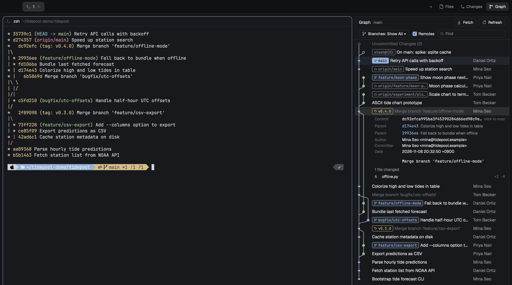

# herdr-git-graph

**English** · [한국어](README.ko.md)

A native recreation of the VS Code Git Graph view for Herdr's side panel, with Git Graph's full
right-click menus (commit, branch, current branch, remote branch, tag, uncommitted changes and
stash, including Drop, Fetch into local and Archive) with guards re-checked right before each
action, click-only confirmation for destructive actions, a per-space Diff tab (or split pane)
with unified and side-by-side views, a Branches filter dropdown and Find. No code from the
VS Code Git Graph extension is used. `RECIPE.md` describes how to build it from scratch.



## Features (beyond the graph itself)

- **Copy Commit Message / Copy Stash Message to Clipboard** in the right-click menu: the
  full message (subject and body), read with `git log -1 --format=%B` when chosen.
- **Selectable commit details**: in an expanded commit, the message body and the
  Author / Committer / Date values can be drag-selected and copied with cmd-c. The full
  hash stays click-to-copy.
- **Diff in its own tab** (default): clicking a file opens the space's one **Diff** tab
  (opened on first use, reused after that). The diff header's **Open in: Tab | Pane**
  toggle switches to the old behavior, a diff pane split in beside the work; the choice is
  shared (`git-graph.diffWhere` = `tab` | `split`). Esc or ✕ closes the diff tab (or pane).
  While a diff tab or pane has the focus, the Graph keeps showing its repository.
- **Ref chips**: drawn in the monospace font so their widths are exact (names over 22
  columns end in "…"), each with an icon (branch; check for the checked-out branch; cloud
  for a remote branch; tag; commit for a detached HEAD). A local branch and its same-named
  remote branch on the same commit share one chip (`main | origin`); right-click or
  double-click acts on the part under the pointer. The checked-out branch's chip is filled
  with its lane color and comes first; HEAD's row has a faint tint of that color.
- **Double-click a branch label** to check it out (a remote branch opens the Checkout dialog).
  A single click on a label only selects the row; it doesn't expand it.
- **Expanding a commit scrolls it into view**: the row and its details come on screen,
  moving only as far as needed.
- **Lane colors**: 12 colors from the theme's ansi palette, starting with blue,
  drawn at full saturation so pastel themes still give vivid lanes.
- **Fetch prunes**: the header Fetch runs `git fetch --all --prune`, so a remote branch
  deleted on the server (a PR branch after merge) disappears from the graph. Local branches
  are not touched.
- **Branches dropdown** floats over the graph instead of pushing it down.

## Install (development)

```sh
scripts/link.sh          # copies mods/* into ~/.config/herdr-app/mods
scripts/watch-copy.sh    # keep the copy in sync while editing (needs fswatch)
scripts/link.sh --link   # symlink instead (see below)
```

Herdr's hot reload does not pick up edits made through a symlinked mod
folder (verified: `herdr-app check` passes, but a live pane kept the old
render after editing). A copied folder reloads immediately, so copying is the
default. The script never overwrites an existing real folder it did not create.

Tests: `npm test`.

## Install into the right panel

Herdr's shipped layouts (`main`, `terminals`, `win98`) are Herdr's: they are
replaced on every start, and an edited one is set aside as `<name>-edited`.
So clone the layout, patch only the clone, and switch to it:

```sh
HA=/Applications/Herdr.app/Contents/MacOS/Herdr
scripts/link.sh
$HA do layout.clone '{"name":"main","as":"main-graph"}'   # also switches to it
node scripts/patch-layout.mjs ~/.config/herdr-app/layouts/main-graph.json
$HA do layout.switch '{"name":"main-graph"}'
```

The patch adds a `graph` block to the `panel-body` stack and swaps the `tabs`
bar for `git-graph-tabs` (a clone of `tabs` with a Graph button after Changes).
It is idempotent, refuses `main.json`, `terminals.json` and `win98.json`
(exit 1, nothing written), and writes `<layout>.json.bak` once: the clone as it
was before its first patch. The Graph button shows only on a layout whose
`panel-body` has a `graph` block, so `git-graph-tabs` is harmless elsewhere.

Keys: merge the repo's `keys.json` into `~/.config/herdr-app/keys.json`. `cmd-g` on macOS,
`ctrl-shift-g` on Windows and Linux (`git-graph-tabs.graph`) opens the Graph panel and
focuses it, or closes it, like the button. `cmd-f` / `ctrl-f` (`git-graph.find`) jumps to
Find while the panel has focus (`/` also works). keys.json has no per-OS section, so the
file carries both; `cmd` is the Windows key elsewhere, and `cmd-g` there is the system's.

The repo's `mods/` folders are the source: edit there and re-run
`scripts/link.sh`, never the copies in `~/.config/herdr-app/mods`.

## Undo

Switch back to the shipped layout (`$HA do layout.switch '{"name":"main"}'`),
which was never edited. Optionally restore `<clone>.json.bak` over the clone (its
first-run state) or delete the clone. Then delete
`~/.config/herdr-app/mods/git-graph` and `~/.config/herdr-app/mods/git-graph-tabs`.

## Known limits

- Windows is not supported: actions run `env GIT_TERMINAL_PROMPT=0 ... git`, and `env` does not exist there.
- Create Archive is hidden in a space that runs on another machine (its folder picker and file
  check are local).
- The Graph button only appears on a layout whose `panel-body` has a `graph` block (the patch adds one).
- `npm test` covers the pure libraries, the layout patch and real-git guard tests; the panel's
  drawing itself is checked by hand in a live Herdr window.

## License

MIT, see `LICENSE`.
