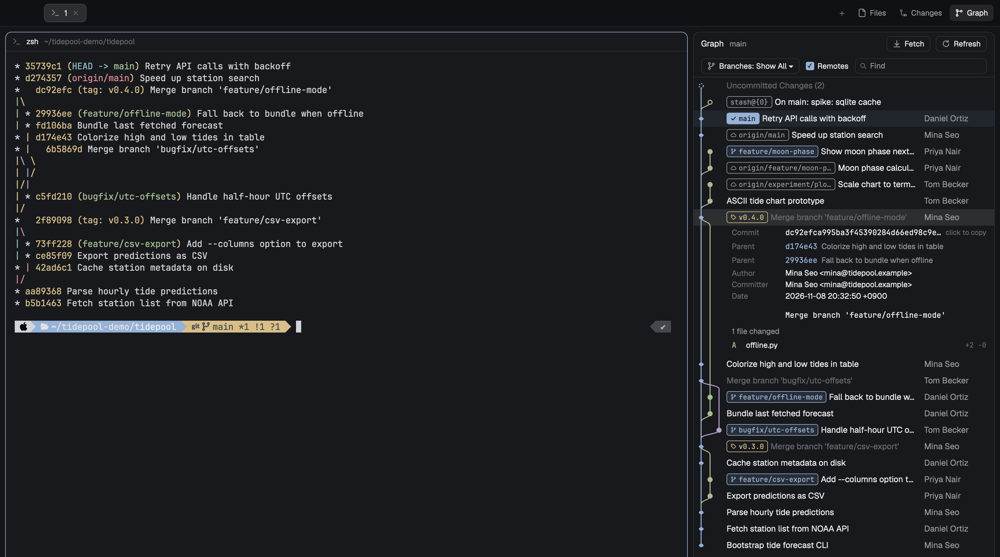

# Git Graph

A commit graph for the git repository you are working in, in Herdr's right-hand side panel next to Files and Changes. You see branches as colored lanes, click a commit to read it, click a file to see its diff in its own tab, and right-click anything (a commit, a branch, a tag, a stash, the uncommitted changes) for the same actions the VS Code Git Graph extension offers. Two mods make it: `git-graph` (the panel, the menus, the dialogs and the diff view) and `git-graph-tabs` (a copy of Herdr's `tabs` bar with a Graph button).

## What you see

**Graph panel** (mod `git-graph`, a `graph` block in the layout's `panel-body` stack). A rounded box (radius 10, 1px `border`, `background` fill, 13px text) with three parts, top to bottom:

- Title row, 36px high, 12px side padding: "Graph" (semibold), then the checked-out branch name (12px, `muted`; the short hash when detached), then a 14px spinner (`accent`) and the running action's name plus "…" while an action runs (text hidden under 360px width). Right-aligned: **Fetch** and **Refresh** buttons (24px high, 1px `border`, 12px text, icons `fetch.svg` and `refresh.svg`). Under 360px wide they show icons only. Fetch is disabled when the repo has no remotes or an action is running.
- Controls row, 34px high: **Branches: All ▾** button (max 200px wide, 120px compact; border `accent` while open or filtered), a **Show Remote Branches** checkbox (13px box, `accent` fill when on; "Remotes" under 560px, a cloud icon under 360px), and a **Find** box (24px high, flex, min 60px, search icon, a match counter like `2/5` at its right, red `ansi1` when there are none). A 1px `border` line closes the header.
- The commit list. Rows are 26px high and 10px right padding. Left: a graph cell, `10 + 14 x lanes` px wide (the same for every row, at most 12 lanes), where each lane is a 1.5px line with 14px between lane centres, curving between lanes; a commit is a filled dot of radius 4, a stash a hollow ring (background fill, 1.5px ring), the Uncommitted Changes row a dashed ring (dash 2,2). Then ref chips, then the subject (`foreground`; `dim` for merge commits and the uncommitted row, `accent` for the current Find match). Columns appear with width: author (110px, `muted`) from 420px, date (76px, `muted`, "3h ago", "2d ago", "1w ago", "4mo ago", "2y ago") from 560px, short hash (70px, monospace 11px, `dim`) from 680px. The top row is `Uncommitted Changes (N)` when the tree is dirty. A list longer than 300 commits ends in "Loading more commits…" and loads 300 more as it scrolls into view.
- Lane colors, in order: `ansi4` (blue), `ansi2`, `ansi5`, `ansi3`, `ansi6`, `ansi1`, `ansi12`, `ansi10`, `ansi13`, `ansi11`, `ansi14`, `ansi9`, then they repeat.
- Row fills: selected or current Find match `selected`; other Find matches `selection`; the expanded row `surface`; HEAD's row a 14-hex-alpha tint of its lane color; hover `hover`.

**Ref chips** are 18px high, drawn in JetBrains Mono 11px (glyph advance 6.6px), 4px apart, 1px border, radius 4, 5px side padding. Each starts with a 10px icon in a 13px slot: `branch.svg`, `check.svg` for the checked-out branch, `cloud.svg` for a remote branch, `tag.svg`, `commit.svg` for a detached HEAD. Labels over 22 columns end in "…"; a Chinese, Japanese, Korean or emoji character takes 2 columns, Hangul jamo vowels and final consonants take 0. Colors: local branch `muted` text with an `accent` 13% tint, tag `ansi3`, remote `muted`. The checked-out branch is filled with its lane color (text is whichever of `background` or `foreground` contrasts more) and sorts first on its commit; a detached HEAD chip "HEAD" is filled with `accent`. A local branch and a same-named remote branch on the same commit share one chip: `main | origin`, the second part showing only the remote name on a 10% tint.

**Expanded commit** (click a row): under it, rows 22px high on a `surface` background with the lanes continuing straight down at the left: `Commit` with the full hash (monospace 12px, click to copy, shows "Copied" in `accent` for 1.5s); one `Parent` line per parent (short hash in `accent`, its subject; click jumps to it); Author, Committer and Date lines (18px lines, selectable text, date in full); the message body (selectable, monospace 12px, up to 200 lines); `N files changed`; then one line per file: change letter (A `ansi2`, M `ansi3`, D `ansi1`, R `ansi4`, U `ansi2`; a conflict uses `blocked`), the path (`from → path` for renames), and `+added -removed`. The Uncommitted row expands to `Staged (N)` and `Changes (N)` groups (untracked files and conflicts count under Changes, marked `U`), or "No changes".

**Branches dropdown**: a 260px wide box (at most 320px high, 16px margin to the panel bottom, shrinks to panel width less 16px, min 120px) floating over the list at left 12px, just below the header, `popover` fill, 1px `border`, radius 8, large shadow. Rows are 24px: a "Show All" checkbox first, then every local branch, then (when remotes are shown) every remote branch in `muted`.

**Right-click menu** (a popup overlay, 290px wide, height from its rows): 5px padding, `popover` fill, a 26px title line (11.5px, `dim`: `commit 1a2b3c4 · subject`, `branch x`, `remote origin/x`, `tag x`, `stash@{0}`, or `Uncommitted changes`), then 31px rows (12.8px text, 8px side padding, radius 7; the keyboard row `selected`, hover `hover`) and 9px separators (1px `border`).

**Action dialog** (a dialog overlay, 440px wide): 18px padding, `popover` fill. Title 15px semibold with "Esc" (11px, `dim`) at the right; a `muted` detail line; fields; a footer with Cancel and a confirm button (32px high, radius 8, 12.5px). Field kinds: text (32px high input, radius 8, `accent` border when focused, 11.5px `dim` label), checkbox (28px rows, 14px box), radio (26px rows, 14px round dot), and select (a row of buttons, the chosen one with an `accent` border). The confirm button is `solid` with `solid_foreground` text; for a destructive dialog it is `ansi1` and the footer reads "Click to confirm". Its height is `36 + 26 + 30 + 52` plus 58 per text field, 28 per checkbox, `24 + 26 x options` per radio, 56 per select (plus 36 for Archive's error line).

**Diff view** (the same mod, `props.diff.tab`): by default one tab named `Diff` per space holding only this pane; with `Open in: Pane` it is a pane split in on the right of the current tab. Top: a 36px header on `surface` with a bottom 1px `border`: the path (13px; `from → path` for a rename) over a 11px `dim` line (the commit's short hash, or `Working tree (staged)` / `(unstaged)` / `(untracked)`), a `Unified | Split` toggle, an `Open in: Tab | Pane` toggle (22px buttons, active one `selected`), `Open in nvim` when the helper exists (see Watch out), and a `✕` button. Below: the diff in the person's monospace font at 12px, rows 20px high. Gutter width is `8 x digits + 10` px, digits at least 3. A line is `ansi2` at 13% alpha (`22` hex) when added, `ansi1` at 13% when removed, the sign column 14px wide in the same color. Hunk headers (`@@ ... @@`) and notices sit on `surface` in `dim`. Side by side puts old on the left and new on the right with a 1px `border` divider, pairing each run of removed lines with the run of added lines after it and padding the shorter side with `surface` blanks.

**Tabs bar** (mod `git-graph-tabs`): Herdr's `tabs` bar unchanged except a **Graph** button, 26px high with `mods/git-graph/graph.svg`, after Files and Changes. Tabs are 29px high, radius 7, 12.8px text; the panel buttons are 26px high, 12px text, 8px padding, `selected` fill when their panel is open.

## How it behaves

- **Which repo**: the one of the focused pane's folder, else a terminal's folder in the same tab, else the space's folder (same rule as Herdr's `changes` mod; a space on another machine runs git there). While a diff tab or pane has the focus, the Graph keeps its repository. A folder that is not a repo shows "Not a git repository"; a repo with no commits "No commits yet"; no folder "No folder"; a failed load shows the error in `ansi1`.
- **Refresh**: the panel reloads every 10 seconds, whenever the repo's files change (`watchFolder`), and after any action finishes. Status states: loading ("Loading…"), ready, error. There are no agent statuses in this mod.
- **Keyboard** (panel focused): Up and Down move the selected row; Enter expands or collapses it; Esc collapses (or closes the Branches dropdown first); `/` jumps to Find. In Find: typing jumps to the first match, Enter or Shift-Enter steps to the next or previous (wrapping), Esc clears it and returns to the list. Find matches subject, author, hash prefix, and branch, remote and tag names (for stashes: subject, selector, hash). The panel also takes the commands `up`, `down`, `toggle`, `collapse`, `find` and `focus` from `keys.json` (`mod:git-graph` section: `"git-graph.up"` and so on).
- **Mouse**: a click on a row expands it (collapsing any other) and scrolls it and its details into view; a click on a ref chip only selects the row; a double-click on a local branch chip (not the current one) checks it out at once, on a remote chip opens the Checkout dialog; the current branch, tags and detached HEAD do nothing. A click on a file opens its diff. A click on the Parent line scrolls to the parent. The wheel scrolls; a drag in the message or Author / Date text selects it (cmd-c copies).
- **Right-click** on a chip acts on the part under the pointer (local part or paired remote part); anywhere else on a row it acts on the commit, stash or uncommitted changes. The menu captures names and hashes at that moment.
- **Menus** (Up, Down, Enter, Esc, or click; a held Enter never runs). Items marked * need a checked-out branch (not detached HEAD); a separator is dropped when it would be first, last or doubled.
  - Commit: Add Tag…, Create Branch…, -, Checkout…, Cherry Pick…, Revert…, Drop…, -, Merge into current branch…*, Rebase current branch on this Commit…*, Reset current branch to this Commit…*, -, Copy Commit Hash / Subject / Message to Clipboard. Drop shows only for a commit with one parent that is on the current branch with no merge commit between it and HEAD (asked of git at right-click). Cherry Pick and Revert of a merge commit ask for the parent number.
  - Branch, not current: Checkout Branch (runs at once), Rename Branch…, Delete Branch…, Merge into current branch…*, Rebase current branch on Branch…*, Push Branch… (only with remotes), -, Create Archive (not on a remote space), Unselect in Branches Dropdown (only if it is in the filter), -, Copy Branch Name to Clipboard.
  - Current branch: Rename Branch…, Push Branch… (with remotes), -, Create Archive, Unselect in Branches Dropdown (if filtered), -, Copy Branch Name.
  - Remote branch: Checkout Branch…, Delete Remote Branch…, Fetch into local branch…, Merge into current branch…*, Pull into current branch…*, -, Create Archive, Unselect in Branches Dropdown (if filtered), -, Copy Branch Name.
  - Tag: View Details (annotated tags only), Delete Tag…, Push Tag… (with remotes), -, Create Archive, -, Copy Tag Name.
  - Uncommitted changes: Stash uncommitted changes…, Reset uncommitted changes…, Clean untracked files…, -, Open Changes panel (selects the `changes` block of `panel-body` and shows `panel`).
  - Stash: Apply Stash…, Create Branch from Stash…, Pop Stash…, Drop Stash…, -, Copy Stash Name / Hash / Message to Clipboard.
  - Copy items write to the clipboard and show an info toast titled "Copied" for 2s with the text (the subject only for a message). A message copy reads `git log -1 --format=%B` first and the menu stays open until it ends (10s limit).
- **Dialogs** (fields and defaults): Add Tag: name, Annotated tag (on), message (optional), and with remotes Push to remote plus a remote choice. Create Branch: name, Check out. Checkout Commit: none. Cherry Pick: parent (merge only), No commit. Revert: parent (merge only). Merge: "Create a new commit even if fast-forward is possible" (on), Squash commits, No commit. Rebase: none. Reset: radio Soft / Mixed (default) / Hard (soft not offered for uncommitted changes). Rename: new name (prefilled). Delete Branch: Force delete. Push Branch: remote, Set upstream (on), Force push (with lease). Create Archive: format zip or tar, file name (optional, default `<ref with / as ->.<format>`), folder with a Choose folder… button (system folder picker). Checkout Remote: local branch name (prefilled). Fetch into Local: local branch (prefilled), Force. Pull: no-ff, squash. Delete Tag: also delete on remote plus remote choice. Push Tag: remote. Stash: Include untracked files (on), message (optional). Clean: Also directories. Apply / Pop Stash: Restore index. Create Branch from Stash: name. Tag details: tagger, date, commit, message, a Close button. Required text fields keep the confirm button dimmed (opacity 0.45) while empty. Enter confirms; Esc cancels. Destructive dialogs (Drop, Reset, Reset Uncommitted, Delete Branch, Delete Remote Branch, Delete Tag, Clean, Drop Stash) and any dialog with Force ticked ignore Enter: only a click on the confirm button runs them. Create Archive refuses to overwrite and says "File exists: <path>" inline.
- **Running an action**: the dialog or menu hands the plan to the panel that opened it. The panel takes a per-repo busy lock (shown in the header as spinner and label, with a toast "Git Graph is busy" if another action starts, and ignored after 15 minutes), re-checks the guards, then runs the steps in order, stopping at the first failure. A failed guard toasts `<Action> not run` (error) with its message and runs nothing. A failure toasts `<Action> failed` with the last 400 characters of git's output. Conflicts that appear during the run toast "Conflicts: Resolve in nvim or Changes" (warning). Then every Graph refreshes. The same busy lock covers Fetch.
- **Guards** (git checks run immediately before the steps; the menu was built from a snapshot, so each fails with a toast instead of acting on something that moved): current-branch actions (Drop, Merge, Rebase, Reset, Pull) require the checked-out branch to still be the one shown ("Current branch changed to X — reopen the menu."); Drop also requires the commit to be an ancestor of HEAD and no merge commit between it and HEAD; Reset also requires HEAD to still be on the commit it was at; Delete Branch requires the branch tip unchanged; Merge of a branch requires its name to still resolve to the shown commit (so a same-named tag cannot win); the four stash actions (Apply, Pop, Create Branch, Drop) require the stash at that index to be the same commit (a newer stash shifts indexes).
- **Diff view**: a file click loads that diff (`git diff` for the commit's change against its first parent, or the empty tree for a root commit; `--cached`, plain, or `--no-index` against `/dev/null` for staged, unstaged and untracked files). Up to 20,000 diff lines show, then a notice. A binary file shows "Binary file · no diff"; no hunks "No content changes" (a rename: "Renamed from X · no content changes"); a vanished file "This file is no longer available". Esc or ✕ closes the Diff tab when the pane is all it holds (else only the pane), and a split pane just closes. `Unified | Split` is shared (`git-graph.diffMode`) as is `Open in:` (`git-graph.diffWhere`: `tab` default, or `split`). The tab is opened on first use (named `Diff`, tracked per space) and reused afterwards; if it has not appeared within the wait a warning toast "The diff tab has not appeared yet." shows. In split mode with no suitable pane to split from the toast reads "No pane in this tab to open the diff beside." `Open in nvim` runs the `herdr-nvim` wrapper on the file (only when `mods/herdr-nvim/bin/herdr-nvim` exists, the repo is local and the file is not deleted); a failure toasts "herdr-nvim open failed".
- **Tabs bar**: as Herdr's `tabs`: click a tab to select, double-click to rename, drag to reorder, right-click for the tab menu, wheel to switch, `+` for the new-tab menu; the active tab shows its close button, working tabs a spinner, blocked or done tabs a 6px dot in `blocked` or `done`. The Graph button toggles the panel: on a layout with a `graph` block it adds `graph` to the panel buttons (Files, Changes, Graph); it selects `graph` in `panel-body` and shows `panel`, or hides `panel` when Graph is already open. It remembers the panel (closed, or which of the buttons) per space in the mod's `localStorage` and restores it on a space switch.

## Built from

**Layout.** Herdr's shipped layouts (`main`, `terminals`, `win98`) are replaced on every start, so do not edit them. Clone one and patch the clone: `layout.clone {"name":"main","as":"main-graph"}`, then run `node scripts/patch-layout.mjs ~/.config/herdr-app/layouts/main-graph.json`, then `layout.switch {"name":"main-graph"}`. The script (`scripts/patch-layout.mjs`, exports `patchLayout` and `SHIPPED`): finds the `stack` with id `panel-body` and appends `{"id":"graph","type":"block","content":{"mod":"git-graph"}}` unless one exists; turns every block with `content.mod` `tabs` into `{"mod":"git-graph-tabs","props":{"replaces":{"mod":"tabs"}}}`; throws if there is no `panel-body` stack, no `children` array, or no tabs block; refuses `main.json`, `terminals.json` and `win98.json` (exit 1, nothing written); is idempotent; keeps the file's 2- or 4-space indent; writes `<file>.bak` once with the original text; writes through a temp file and rename. `scripts/link.sh` copies each `mods/*` folder into `~/.config/herdr-app/mods` (`--link` symlinks), refusing to replace a real folder it did not create (it marks its copies with `.git-graph-copy`). `scripts/watch-copy.sh` re-copies on change (needs fswatch). `scripts/make-fixture.sh <dir>` builds a deterministic repo (`origin.git` and `work`) for the tests.

**Mod `git-graph`** (`mod.json`: `{"place":"none","focusable":true,"title":"Git Graph"}`). One entry, `main.js`, reads `props()` from `herdr` (not the argument of `init`, which does not carry them) and picks a view: `props.diff.tab` is the diff view, `props.menu` the menu, `props.dialog` the dialog, anything else the panel. Use `gpui-kit` (`View`, `div`, `svg`, `PathBuilder`) and `gpui-base` (`v_flex`, `h_flex`, `Scrollbar`, `v_virtual_list`, `VirtualListScrollHandle`, `InputState`, `Input`, `Checkbox`, `TextView`). Files: `lib/` holds the pure logic (`parse.js` for git output, `lanes.js` for lane layout, `format.js` for chip widths, columns and dates, `filter.js` for the branch filter and Find, `details.js`, `actions.js` for menus, dialogs, plans and guards, `targets.js`, `run.js` for argv, timeouts, busy lock and outcomes, `diff.js` and `diffview.js`, `color.js`, `location.js`, `git.js`), and `ui/` the views (`panel.js`, `header.js`, `graph-cell.js`, `details.js`, `menu.js`, `dialog.js`, `diff-pane.js`, `repo.js`, `run.js`). `icons/` has `branch`, `check`, `cloud`, `commit`, `fetch`, `refresh`, `search`, `spinner`, `tag` SVGs, and `graph.svg` is the Graph button's icon.

**Mod `git-graph-tabs`** (`mod.json`: `{"place":"none","title":"Tabs","cloned_from":{"name":"tabs","version":"0.1.15"}}`): a clone of the shipped `tabs` mod plus the Graph button and the per-space panel memory. It uses the shipped icons `mods/files/file.svg`, `mods/changes/changes.svg`, `mods/workspace-chrome/spinner.svg`, `mods/pane/close.svg`, its own `win-min/max/restore/close.svg` for Windows window buttons, and the shipped mod `new-menu` (for `+`) and `menu` (tab menu, `props: {tab:"tab", target:{id, space}}`). Theme keys: `chrome`, `border`, `raised`, `hover`, `selected`, `foreground`, `muted`, `dim`, `working`, `blocked`, `done`. Commands: `tab.select`, `tab.rename`, `tab.move`, `tab.close`, `tab.next`, `tab.prev`, `layout.select {stack:"panel-body", child}`, `layout.show {id:"panel"}`, `layout.hide {id:"panel"}`, `window.minimize|maximize|close`. It reads `spaces()`, `panes()`, `layout()`, `window()`, `settings()`, `shared("workspace.panels")`. It leaves room for the macOS window buttons at the left (`traffic_lights[0] + 64`, scaled by zoom, less the sidebar width, at least 10px).

**`herdr` functions and commands the panel uses**: `props`, `theme`, `settings`, `shared`, `setShared`, `nextCommand`, `focused`, `panes`, `spaces`, `run`, `notify`, `openOverlay` (popup for menus, 290px wide; dialog for dialogs, 440px wide, `modal` for Archive so the folder picker does not close it), `closeOverlay`, `watchFolder`, `exec`, `pickFolder`, `readTextFile`, `appHome`; commands `tab.new {space, name:"Diff", mod:"git-graph", props:{diff:{tab:"space:<id>"}}}`, `tab.select`, `tab.close {id}`, `pane.split {direction:"right", pane, mod:"git-graph", props:{diff:{tab}}}`, `pane.close {pane}`, `layout.select`, `layout.show`. Also the clipboard write on the view's context.

**Shared keys**: `git-graph.request` (menu or dialog to panel: `{id, at, owner, root, on, run?:{label, plan}, unselect?}`, ignored after 10s or if not for that panel copy), `git-graph.busy.<root>` (`{label, since}`), `git-graph.changed` (`{root, at}`, makes every Graph refresh), `git-graph.diff.<tab or space:id>` (the diff target), `git-graph.diffPane.<tab>` and `git-graph.diffTab.<space>` (which pane or tab is the diff), `git-graph.diffMode` (`unified` | `split`), `git-graph.diffWhere` (`tab` | `split`).

**Programs run.** Every read is `git` through `exec` with the prefix `--no-optional-locks -c core.fsmonitor=false`, `cwd` the repo root, `on` the space's machine, 30s timeout: `rev-parse --show-toplevel`, `rev-parse --abbrev-ref HEAD`, `rev-parse --verify -q HEAD`, `log --date-order --format=%H%x1f%P%x1f%an%x1f%ae%x1f%at%x1f%s%x1e -n <count> (--branches --tags [--remotes] HEAD | --ignore-missing <refs>) --`, `for-each-ref` over `refs/heads refs/remotes refs/tags`, `stash list`, `status --porcelain=v1 -z --untracked-files=all`, `remote`, `show -s`, `diff --numstat`, `diff --name-status`, `diff-tree --root` for a root commit, `diff --no-color`, `for-each-ref` of one tag, `log -1 --format=%B`. Count starts at 300 and grows by 300. Actions are `exec("env", ["GIT_TERMINAL_PROMPT=0","GIT_EDITOR=true","GIT_MERGE_AUTOEDIT=no","git", ...step])`, so git never prompts or opens an editor. Timeouts per step: 600s for `stash clean checkout rebase merge cherry-pick revert reset pull`, 120s for `push fetch archive`, 30s for the rest (`tag`, `branch`). Plans: Add Tag `tag [-a] name [-m msg] <hash>` then optionally `push <remote> refs/tags/name`; Create Branch `branch name <hash>` or `checkout -b name <hash>`; Checkout `checkout <hash>`; Cherry Pick `cherry-pick [-m n] [--no-commit] <hash>`; Revert `revert --no-edit [-m n] <hash>`; Drop `rebase --onto <hash>^ <hash>`; Merge `merge [--no-ff] [--squash] [--no-commit] <hash or branch>`; Rebase `rebase <hash or refs/heads/x>`; Reset `reset --soft|--mixed|--hard <hash>`; Rename `branch -m old new`; Delete `branch -d|-D`; Push `push [--set-upstream] [--force-with-lease] <remote> <branch>`; Archive `archive --format=zip|tar -o <folder>/<name> <full ref>` (and `test -e <path>` first); Checkout Remote `checkout -b <local> --track <remote/branch>`; Delete Remote `push <remote> --delete <branch>`; Fetch into local `fetch <remote> [+]<branch>:<local>`; Pull `pull [--no-ff] [--squash] <remote> <branch>`; Delete Tag `tag -d` then optionally `push <remote> --delete refs/tags/name`; Push Tag `push <remote> refs/tags/name`; Stash `stash push [--include-untracked] [-m msg]`; Reset uncommitted `reset --mixed|--hard HEAD`; Clean `clean -f [-d]`; stash actions `stash apply|pop [--index] <selector>`, `stash branch <name> <selector>`, `stash drop <selector>`; header Fetch `fetch --all --prune`. Guards are reads such as `symbolic-ref --short -q HEAD`, `rev-parse --verify -q <ref>`, `merge-base --is-ancestor <hash> HEAD`, `rev-list --merges <hash>..HEAD`. After each run a `status` read looks for conflicted files. The optional wrapper `~/.config/herdr-app/mods/herdr-nvim/bin/herdr-nvim open <abs path> --ctx <json>` is run when present.

**Art**: the nine icons above plus `graph.svg` (the button icon). Colors are theme keys only; nothing is hard-coded except the chip font (JetBrains Mono, which ships with Herdr).

## Watch out

- **`props()` not `init`'s argument.** Herdr hands a mod's props (from `openOverlay` or `pane.split`) through `props()` from `herdr`; the argument of `init` does not carry them. The role switch in `main.js` reads `props()` (falling back to the argument), and the menu and dialog read `props()` again on each call.
- **Handlers inside virtual-list items throw.** Item elements are drawn by the list's own renderer; an `on_click` set inside them throws. Put one `on_item_click` and one `on_item_secondary_click` on the list, keyed by item key, and look the item up there. Every clickable detail is its own list item for this reason.
- **Overlay tasks die about 250ms after the overlay closes.** A menu or dialog cannot run an action itself: it writes `git-graph.request` and the panel, which lives on, runs it. The busy lock and the toasts are the panel's. Copying a message is the one read an overlay does itself, so the menu stays open until it ends.
- **`overflow_y_scrollbar()` drops absolute positioning.** The Branches dropdown is two boxes: an absolutely positioned, clipping outer box (`top` = header height 71, `left` 12) and an inner scrolling box. Without that it falls into the flow under the list.
- **`scroll_to_item` only moves as needed.** It does nothing when the item is already visible. To show an expanded commit with its details, scroll to the last item of the block that still fits with the row (`blockRevealIndex`), and do it again once the details have loaded because their height changes.
- **Symlinked mods do not hot-reload.** `herdr-app check` passes but a live pane keeps the old render. Copy the folders (`scripts/link.sh` does), and re-run it after each edit.
- **Pointer positions are in zoomed pixels.** `local_position` scales with `settings().zoom`; chip widths are in layout pixels. Divide by `bounds.height / layoutHeight` (this event's own scale: the row's painted height over 26, or the list's painted height over its measured height) before hit-testing a chip. Use the monospace advance (6.6px per column at 11px) for chip widths; estimating widths breaks hit-testing.
- **Shipped layouts are replaced on start.** Never patch `main.json`, `terminals.json` or `win98.json`; clone first. An edited shipped layout is set aside as `<name>-edited`.
- **The Graph button only shows on a layout whose `panel-body` has a `graph` block**, since the welcome's `workspace.panels` lists only files and changes; `git-graph-tabs` adds `graph` itself in that case and is harmless elsewhere.
- **Guards are read-only and re-run before every action**; do not trust the Target to still be true. Use full ref names (`refs/heads/x`) wherever a same-named tag could win, and `--end-of-options` when resolving a name.
- A branch named like a file is safe because `log` ends its revisions with `--`.
- Limits: 12 lanes (extra lanes draw on the last), chip labels 22 columns, 300 commits per page, 20,000 diff lines, 200 message lines, 50 expanded commits cached, busy lock stale after 15 minutes, request ignored after 10s.
- Not supported: Windows (action steps use `env`); Create Archive is hidden on a space running on another machine; Open in nvim is hidden there too. No syntax highlighting in the diff. The commit detail loads once per commit and is cached, not re-read on refresh.
- Assumes git on the PATH of the machine that holds the repo, and the shipped mods `files`, `changes`, `menu`, `new-menu`, `workspace-chrome` and `pane` for the Graph button's neighbours and icons.

## Done when

- `npm test` passes (165 tests: the pure libraries, the layout patch on a copy of a real layout, and real-git guard tests for a stash index shift, a moved branch tip and a tag named like a branch).
- `herdr-app check` passes for `git-graph` and `git-graph-tabs`, and a patched clone of `main` loads with no `*.error` files and empty `errors` in `herdr-app status`.
- Running `scripts/patch-layout.mjs` twice leaves the same file, and on `main.json` it exits 1 and writes nothing.
- The Graph button toggles the panel like Changes does; the panel shows the focused repo's lanes with the checked-out branch's chip filled with its lane color, a paired `main | origin` chip, and an Uncommitted Changes row when the tree is dirty.
- Clicking a commit expands it with hash, parents, author, date, body and files and scrolls it into view; clicking a file opens the space's one Diff tab, reused on the next click, in Unified and Split views.
- Right-clicking a commit, each kind of ref, the uncommitted row and a stash opens the menu listed above; a destructive dialog ignores Enter and runs only from a click; an action whose branch or stash moved after the menu opened toasts "not run" and changes nothing.
- A double-click on a local branch chip checks it out; Fetch, Refresh, the Branches filter and Find work; resizing the panel past 360, 420, 560 and 680px changes the header and the columns as described.
